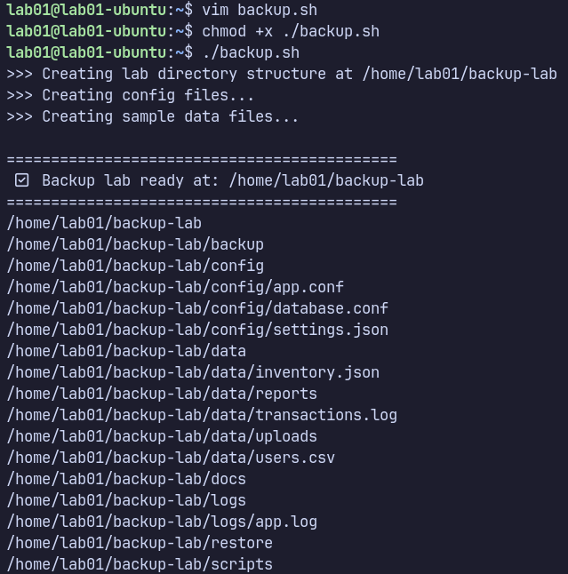
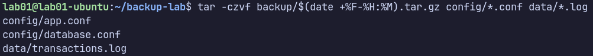
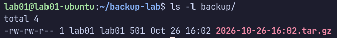
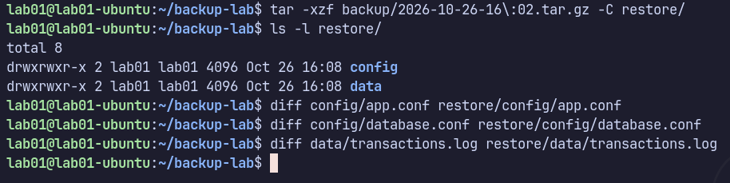
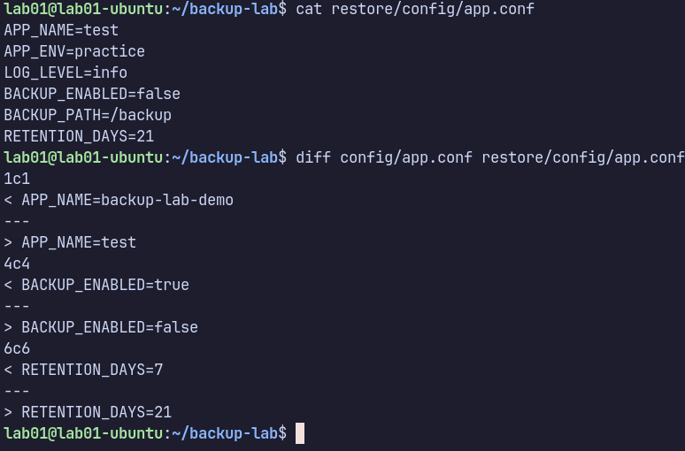

Goal: Learn how to manually back up selected configuration and log files on Ubuntu using the `tar` command, without writing a backup script.

By completing this lab, I will learn how to:

- Inspect the sample files and directories.
- Find command options using the `man` pages.
- Generate a timestamp using the `date` command.
- Create a compressed `.tar.gz` archive containing `.conf` and `.log` files.
- Save the archive in a separate backup directory.
- List archive contents without extracting them.
- Restore the archive into a restore directory.
- Compare the original and restored files using `diff`.
- Verify that the backup works and record the result.

---

First, create a setup script to generate the sample files and directories.
Create the script:
```bash
mkdir -p ~/backup-lab
cd ~/backup-lab
nano setup.sh
```

Copy the environment setup script into `setup.sh` and run it:
```bash
chmod +x setup.sh
./setup.sh
```

```bash
#!/bin/bash
# ============================================
# Manual Backup Lab - Environment Setup
# ============================================

set -e

LAB_DIR="$HOME/backup-lab"

echo ">>> Creating lab directory structure at $LAB_DIR"
mkdir -p "$LAB_DIR"/{config,backup,logs,restore,data,scripts,docs}
cd "$LAB_DIR"

# ---------- CONFIG FILES ----------
echo ">>> Creating config files..."

printf "APP_NAME=backup-lab-demo\nAPP_ENV=practice\nLOG_LEVEL=info\nBACKUP_ENABLED=true\nBACKUP_PATH=/backup\nRETENTION_DAYS=7\n" \
  > config/app.conf

printf "DB_HOST=localhost\nDB_PORT=5432\nDB_NAME=labdb\nDB_USER=labuser\nDB_PASS=secret123\n" \
  > config/database.conf

printf "{\n  \"service\": \"backup-lab\",\n  \"version\": \"1.2.3\",\n  \"features\": [\"backup\", \"restore\", \"verify\"]\n}\n" \
  > config/settings.json

# ---------- SAMPLE DATA ----------
echo ">>> Creating sample data files..."

cat > data/users.csv <<'EOF'
id,username,email,role,created_at
1,alice,alice@example.com,admin,2024-01-15
2,bob,bob@example.com,user,2024-02-20
3,carol,carol@example.com,user,2024-03-05
4,dave,dave@example.com,manager,2024-03-22
5,eve,eve@example.com,user,2024-04-11
EOF

cat > data/transactions.log <<'EOF'
2024-05-01T10:00:01 INFO  TXN-001 user=alice amount=120.50 status=OK
2024-05-01T10:02:14 INFO  TXN-002 user=bob   amount=45.00  status=OK
2024-05-01T10:05:33 WARN  TXN-003 user=carol amount=999.99 status=PENDING
2024-05-01T10:09:47 INFO  TXN-004 user=dave  amount=12.75  status=OK
2024-05-01T10:12:00 ERROR TXN-005 user=eve   amount=0.00   status=FAILED
EOF

cat > data/inventory.json <<'EOF'
{
  "warehouse": "WH-EAST-01",
  "items": [
    {"sku": "A100", "name": "Widget",  "qty": 250, "price": 4.99},
    {"sku": "B200", "name": "Gadget",  "qty": 120, "price": 19.99},
    {"sku": "C300", "name": "Gizmo",   "qty": 75,  "price": 34.50}
  ]
}
EOF

# Create a couple of subfolders with more sample data
mkdir -p data/uploads data/reports
echo "Sample upload content 1" > data/uploads/file1.txt
echo "Sample upload content 2" > data/uploads/file2.txt
seq 1 20 | awk '{print "report-row-"$1",value="$1*7}' > data/reports/report_may.csv

# ---------- EMPTY LOG SEED ----------
echo "$(date '+%Y-%m-%d %H:%M:%S') INFO backup-lab initialized" > logs/app.log
echo
echo "============================================"
echo " ✅ Backup lab ready at: $LAB_DIR"
echo "============================================"
find "$LAB_DIR" -maxdepth 2 -print | sort
```




Before creating a backup, inspect the files that will be included.
```bash
cd ~/backup-lab

find config data logs -type f
```

List the configuration files:
```bash
ls -l config/*.conf
```

List the log files:
```bash
ls -l data/*.log logs/*.log
```

Before using a command, I should understand its options rather than memorizing them.
Open the manual:
```bash
man tar
```

Search for options inside the manual by typing `/` followed by a keyword, then press Enter. Use `n` to move to the next match, `N` to move to the previous match, and `q` to quit.

The command format is:
```bash
tar [OPTIONS] ARCHIVE FILES
```

The options used in this exercise are:

|Option|Meaning|
|---|---|
|`-c`|Create a new archive.|
|`-z`|Compress or decompress using gzip.|
|`-v`|Display the files being processed.|
|`-f`|Specify the archive filename.|
|`-t`|List archive contents.|
|`-x`|Extract archive contents.|

The combination `-czvf` means create a gzip-compressed archive, show the files being processed, and use the filename supplied after the options.

I want each backup archive to have a unique filename containing the current date and time.
Check the date format options:

```bash
date
date +%D
date +%F
date +%H:%M
date +%F-%H:%M
```

**Output**:
```text
%D  -> 10/26/26
%F  -> 2026-10-26
%H:%M -> 15:58
%F-%H:%M -> 2026-10-26-15:58
```

The format specifiers mean:

|Format|Meaning|
|---|---|
|`%F`|Date in `YYYY-MM-DD` format.|
|`%H`|Hour in 24-hour format.|
|`%M`|Minute.|
|`%S`|Second.|

For filenames, I will use:
```bash
date +%F-%H-%M-%S
```

Example:
```text
2026-10-26-16-02-35
```
Using hyphens instead of colons makes the filename easier to handle across different systems.

Create a timestamped archive containing the selected configuration and log files.
```bash
tar -czvf backup/$(date +%F-%H:%M).tar.gz config/*.conf data/*.log
```



Check that the archive exists:
```bash
ls -l /backup
```



Next, inspect the archive without extracting it:
```bash
tar -tzf backup/2026-10-26-16\:02.tar.gz
```

**output**:
```
config/app.conf
config/database.conf
data/transactions.log
```

This confirms that the archive contains the expected file paths.

Extract the archive into the restore directory:
```bash
tar -xzf backup/2026-10-26-16\:02.tar.gz -C restore/
ls -l restore/
```

**output**:
```
total 8
drwxrwxr-x 2 lab01 lab01 4096 Oct 26 16:08 config
drwxrwxr-x 2 lab01 lab01 4096 Oct 26 16:08 data
```

Use the `diff` command to compare an original file with its restored copy.
```bash
diff [OPTIONS] FILE1 FILE2
```

Compare the application configuration file:
```bash
diff config/app.conf restore/config/app.conf
```


If the files are identical, `diff` produces no output and returns exit status `0`.

To understand how `diff` works, deliberately modify the restored copy of `app.conf`.
```bash
lab01@lab01-ubuntu:~/backup-lab$ cat restore/config/app.conf
APP_NAME=test
APP_ENV=practice
LOG_LEVEL=info
BACKUP_ENABLED=false
BACKUP_PATH=/backup
RETENTION_DAYS=21
lab01@lab01-ubuntu:~/backup-lab$ diff config/app.conf restore/config/app.conf
1c1
< APP_NAME=backup-lab-demo
---
> APP_NAME=test
4c4
< BACKUP_ENABLED=true
---
> BACKUP_ENABLED=false
6c6
< RETENTION_DAYS=7
---
> RETENTION_DAYS=21

```



The output shows the differences between the two files.
- `<` indicates a line from the first file.
- `>` indicates a line from the second file.
- `1c1` means that line 1 differs between the files.
- `4c4` and `6c6` indicate differences at lines 4 and 6.
